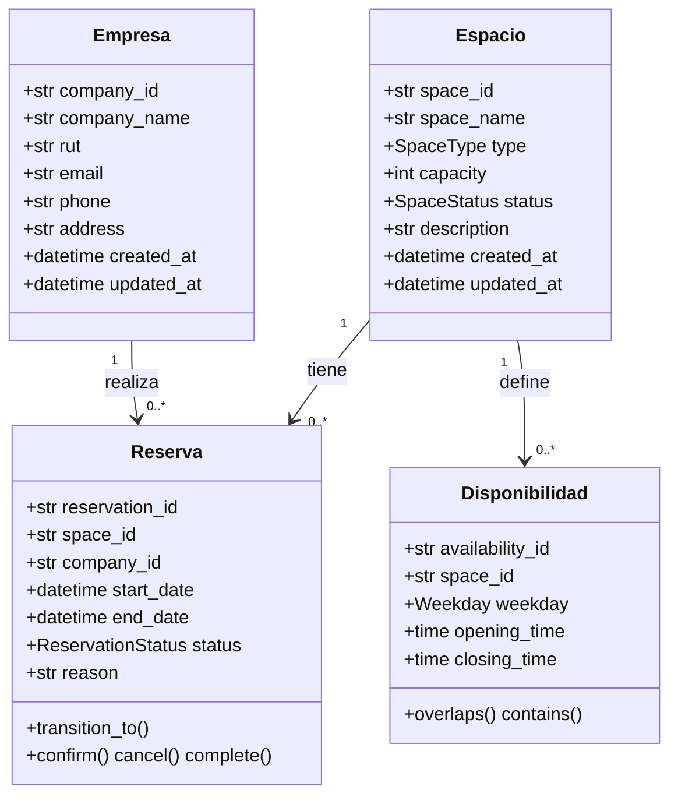

#  Backend 2026 - Grupo 05 | Coworking Reservation API

> **Curso:** Desarrollo de Backend (ICINF1108)  
> **Entrega:** Sin confirmar
> **Estado:** 🟢 En desarrollo

[](https://www.python.org/)
[](https://fastapi.tiangolo.com/)
[](https://docs.pydantic.dev/)
[](./tests)
[](https://docs.astral.sh/ruff/)
[](./LICENSE)

---

##  Resumen Ejecutivo

API REST para la **gestión de reservas de espacios de coworking**, diseñada para resolver los conflictos de duplicidad y superposición de horarios que surgen cuando los administradores utilizan planillas compartidas. Permite administrar espacios, empresas clientas, reservas y disponibilidades horarias, aplicando reglas de negocio reales del dominio.

###  Problemática (P1-P7)

| # | Pregunta | Respuesta |
|---|----------|-----------|
| **P1** | Situación actual | Los administradores de un espacio de coworking registran reservas en una planilla de Google Sheets compartida, generando duplicaciones y conflictos de horario. |
| **P2** | Actores | Administradores del espacio · Empresas/miembros que reservan |
| **P3** | Consecuencias | (1) Dos empresas llegan a la misma sala al mismo tiempo. (2) No existe registro histórico del uso de espacios. |
| **P4** | Información administrada | Espacios, reservas, empresas y disponibilidades horarias. |
| **P5** | Acciones (8+) | CRUD de espacios, empresas, reservas y disponibilidades; verificación de conflictos de horario; consulta filtrada de disponibilidad. |
| **P6** | Exclusiones | Sistema de pagos · Autenticación de usuarios · Notificaciones por email |
| **P7** | Criterios de aceptación | (1) No reservar espacios inactivos. (2) Sin conflictos de horario en un mismo espacio. (3) Una empresa no puede tener dos reservas simultáneas. (4) Fecha fin > fecha inicio. (5) Duración mínima 30 min. |

La API debe permitir:

1. Registrar espacios de coworking.
2. Consultar los espacios disponibles.
3. Modificar la información de un espacio.
4. Eliminar un espacio.
5. Registrar empresas.
6. Registrar y consultar reservas.
7. Modificar o eliminar reservas.
8. Registrar horarios de disponibilidad.
9. Filtrar, ordenar y paginar los listados.
10. Rechazar reservas que tengan conflictos de horario.

---

##  Características Principales

-  **24+ endpoints REST** con métodos HTTP correctos y códigos de estado estandarizados.
-  **CRUD completo** para las 4 entidades del dominio + endpoints de transición de estado (`/confirm`, `/cancel`, `/complete`).
-  **7 reglas de negocio** validadas en la capa de servicios y dominio.
-  **Validación en dos niveles**: schemas Pydantic (formato → 422) + dominio/servicios (reglas de negocio → 400/409).
-  **Filtrado + Ordenamiento + Paginación** en los 4 endpoints GET de listado.
-  **Arquitectura en capas**: routers → services → repositories → domain, con inyección de dependencias (`Depends`).
-  **Manejo global de errores**: un único handler en `main.py` convierte excepciones de dominio (`NotFoundError`, `ConflictError`, `BusinessRuleError`) en una enveloppe JSON consistente. Cero `try/except` en routers.
-  **Fechas 100% UTC**: los datetimes naive se interpretan como UTC y los aware se convierten; nunca se mezclan (evita `TypeError` en comparaciones).
-  **Documentación automática** con Swagger/OpenAPI (incluye modelos de error y de respuesta paginada).
-  **Tests automatizados** con `pytest` (25 tests: reglas de negocio, contrato HTTP y regresiones).
-  **Persistencia real en PostgreSQL** (SQLAlchemy 2.x async + asyncpg): los datos sobreviven reinicios.
-  **Transacción por request**: commit automático al terminar, rollback ante cualquier error; unicidad de RUT/email garantizada también por restricciones UNIQUE de la BD.

---

##  Stack Tecnológico

| Capa | Tecnología | Versión |
|------|------------|---------|
| Lenguaje | Python | 3.11+ |
| Framework | FastAPI | 0.141+ |
| Validación | Pydantic | 2.x |
| Base de datos | PostgreSQL | 16 (compose) / 15+ |
| ORM | SQLAlchemy (async) + asyncpg | 2.x |
| Servidor | Uvicorn | (incluido en `fastapi[standard]`) |
| Documentación | Swagger UI / OpenAPI | Automático |
| Contenedores | Docker (multi-stage + uv) + Compose | `Dockerfile`, `docker-compose.yml` |
| Tests | pytest + TestClient (SQLite) | 25 tests |
| Lint/Format | Ruff | Configurado en `pyproject.toml` |
| Pruebas manuales | REST Client / Thunder Client | `tests_manual/coworking.http` |

---

##  Instalación y Ejecución

### Requisitos previos

- Python 3.11 o superior
- uv (gestor de dependencias)
- Git
- PostgreSQL 15+ (o Docker Compose, que lo levanta por ti)

### Opción A — Docker Compose (recomendada)

Levanta la API + PostgreSQL con un solo comando:

```bash
docker compose up --build
# API en http://localhost:8000 · BD en localhost:5432 (coworking/coworking)
```

> La BD usa una **imagen PostgreSQL personalizada** (`db/Dockerfile`): en la primera inicialización del volumen ejecuta `01-schema.sql` (tablas idénticas al ORM) y `02-seed.sql` (datos de demostración: 4 espacios, 3 empresas, disponibilidades y reservas). Ambos scripts son idempotentes y conviven con el `create_all` de la app. Para partir con la BD vacía: `docker compose down -v`.

### Opción B — Local con uv

```bash
# 1. Clonar el repositorio
git clone https://github.com/Vicenkks/backend-2026-grupo-05.git
cd backend-2026-grupo-05

# 2. Instalar dependencias (incluye el grupo dev: pytest + ruff + aiosqlite)
uv sync

# 3. Configurar la BD (ver .env.example)
cp .env.example .env   # y ajustar DATABASE_URL si tu Postgres difiere

# 4. Ejecutar el servidor (crea las tablas automáticamente al arrancar)
uv run uvicorn app.main:app --reload
```

> El esquema se crea/actualiza con `Base.metadata.create_all` en el lifespan (idempotente). Para evoluciones de esquema en producción se recomienda migrar a Alembic (ver mejoras futuras).

### Ejecución con Docker

Imagen de producción multi-stage (slim, sin herramientas de build, usuario no-root, healthcheck sobre `GET /`):

```bash
# Solo la API (requiere un Postgres accesible vía DATABASE_URL)
docker build -t coworking-api .
docker run --rm -p 8000:8000 \
  -e DATABASE_URL=postgresql+asyncpg://coworking:coworking@db:5432/coworking \
  coworking-api

# Stack completo (API + PostgreSQL con esquema/seed, volumen y healthchecks)
docker compose up --build

# Solo la imagen de base de datos personalizada
docker build -t coworking-db ./db
docker run --rm -p 5432:5432 coworking-db   # credenciales por defecto: coworking/coworking
```

> Las dependencias se instalan con `uv sync --frozen --no-dev`: build reproducible a partir de `uv.lock` y sin pytest/ruff en la imagen final.

### Correr los tests y el linter

```bash
uv run pytest          # 25 tests automatizados
uv run ruff check .    # lint
uv run ruff format .   # formato (line-length 120)
```

>  La API estará disponible en: **http://localhost:8000**  
>  Documentación Swagger: **http://localhost:8000/docs**  
>  Documentación ReDoc: **http://localhost:8000/redoc**

---

## Estructura del Proyecto

```
backend-2026-grupo-05/
├── app/
│   ├── __init__.py
│   ├── main.py                  # FastAPI app + handlers GLOBALES de error
│   ├── dependencies.py          # Composición: repos, servicios y get_*_service()
│   │
│   ├── core/
│   │   ├── exceptions.py        # ApiError, NotFoundError, ConflictError, BusinessRuleError
│   │   ├── base_schema.py       # ApiModel (camelCase aliases + from_attributes)
│   │   ├── config.py            # Settings (DATABASE_URL via env/.env)
│   │   └── listing.py           # helper de orden + paginación
│   │
│   ├── db/
│   │   ├── models.py            # tablas SQLAlchemy (spaces, companies, reservations, availabilities)
│   │   └── session.py           # get_session (transacción por request) + parse_uuid
│   │
│   ├── routers/                 # solo HTTP: parseo, delegación, serialización
│   │   ├── spaces.py
│   │   ├── companies.py
│   │   ├── reservations.py
│   │   └── availabilities.py
│   │
│   ├── schemas/                 # DTOs Pydantic (Create/Update/Response/filtros)
│   │   ├── space.py
│   │   ├── company.py
│   │   ├── reservation.py
│   │   ├── availability.py
│   │   ├── pagination.py        # Pagination (query) + Paginated[T] (respuesta)
│   │   ├── filter.py            # filtros y ListQuery compuestos por recurso
│   │   ├── error.py             # ErrorResponse (documentación de errores)
│   │   └── __init__.py
│   │
│   ├── domain/                  # dataclasses puras + reglas del dominio
│   │   ├── space.py             # Space, SpaceType, SpaceStatus
│   │   ├── company.py           # Company (RUT módulo 11, email)
│   │   ├── reservation.py       # Reservation + máquina de estados
│   │   ├── availability.py      # Availability, Weekday
│   │   ├── validators.py        # validate_text, utc_now, ensure_utc, validate_rut
│   │   └── __init__.py
│   │
│   ├── services/                # casos de uso: única capa que lanza ApiError
│   │   ├── space_service.py
│   │   ├── company_service.py
│   │   ├── reservation_service.py
│   │   └── availability_service.py
│   │
│   └── repositories/            # persistencia SQL: mapeo ORM <-> dominio
│       ├── space_repository.py
│       ├── company_repository.py
│       ├── reservation_repository.py
│       └── availability_repository.py
│
├── tests/                       # pytest: reglas de negocio + contrato + regresiones
│   ├── conftest.py
│   ├── test_business_rules.py
│   ├── test_api_contract.py
│   └── test_review_regressions.py
│
├── tests_manual/
│   └── coworking.http
│
├── db/                          # imagen Docker de PostgreSQL personalizada
│   ├── Dockerfile               # postgres:16-alpine + credenciales + init scripts
│   └── init/
│       ├── 01-schema.sql        # tablas (idénticas al ORM; create_all convive)
│       └── 02-seed.sql          # datos de demostración (idempotente)
│
├── Dockerfile                   # imagen de producción (multi-stage, uv, no-root)
├── docker-compose.yml           # API + PostgreSQL 16 (volumen + healthchecks)
├── .dockerignore
├── .env.example                 # plantilla de variables de entorno
├── README.md
└── pyproject.toml
```

---

##  Integrantes y Responsabilidades

| Integrante | Rol | Responsabilidad Principal | GitHub |
|------------|-----|---------------------------|--------|
| Vicente Huilcaman | Jefe/a de grupo | Coordinación + Documentación e integración |
| Matias Espinoza | Desarrollador | Dominio y datos |
| Annan John | Desarrollador | API y lógica de negocio |
| Alonso Astete | Desarrollador | Calidad y pruebas |

> En grupos de 5 integrantes, la quinta persona asume un área adicional.

---

##  Modelo del Dominio

### Diagrama de Clases



### Reglas de Negocio

| # | Regla | Dónde se valida | Error |
|---|-------|-----------------|-------|
| **RN1** | No se puede reservar un espacio `inactive`/`maintenance`, ni cambiar a esos estados un espacio con reservas futuras activas. | `ReservationService` + `SpaceService` | 400 / 409 |
| **RN2** | No puede haber reservas activas que se superpongan en el mismo espacio. | `ReservationService._ensure_no_conflicts` | 409 |
| **RN3** | Una empresa no puede tener dos reservas activas simultáneas. | `ReservationService._ensure_no_conflicts` | 409 |
| **RN4** | `end_date > start_date` y duración mínima de 30 minutos. | Schema (422) + dominio (400) | 422 / 400 |
| **RN5** | La reserva debe caber en las ventanas de disponibilidad del espacio (si existen para ese día; ver política abajo). | `ReservationService._ensure_within_availability` | 400 |
| **RN6** | Máquina de estados de la reserva: `pending → confirmed → completed`, con `canceled` reachable desde `pending`/`confirmed`. `canceled` y `completed` son **terminales**. | `Reservation.transition_to` | 400 |
| **RN7** | RUT (con dígito verificador módulo 11) y email únicos por empresa. | `CompanyService._ensure_unique` + dominio | 409 / 400 |

**Política de disponibilidad (RN5):** para cada día que atraviesa la reserva, si el espacio tiene ventanas cargadas para ese día de la semana, el tramo correspondiente debe caber completo en una de ellas. Los días *sin* ventanas cargadas no tienen restricción horaria (permite operar espacios sin disponibilidad configurada).

---

##  Contrato de la API

**Convenciones:** campos de entidades en **camelCase** en el JSON (`spaceId`, `startDate`, `createdAt`); también se aceptan en snake_case al enviar (`populate_by_name`). Query params en **snake_case** (`sort_by`, `min_capacity`). Todas las fechas viajan en **UTC** (las naive se interpretan como UTC).

### Endpoints — Espacios

| Método | URI | Descripción | Código éxito |
|--------|-----|-------------|--------------|
| `POST` | `/spaces` | Crear un nuevo espacio | 201 |
| `GET` | `/spaces` | Listar (filtro `type`, `status`, `min_capacity` + orden + paginación) | 200 |
| `GET` | `/spaces/{id}` | Obtener un espacio por ID | 200 |
| `PUT`/`PATCH` | `/spaces/{id}` | Actualizar un espacio (parcial permitido) | 200 |
| `DELETE` | `/spaces/{id}` | Eliminar (409 si tiene reservas activas; cascada en disponibilidades) | 204 |

### Endpoints — Empresas

| Método | URI | Descripción | Código éxito |
|--------|-----|-------------|--------------|
| `POST` | `/companies` | Crear (409 si RUT o email duplicado) | 201 |
| `GET` | `/companies` | Listar (filtro `name`, `rut` + orden + paginación) | 200 |
| `GET` | `/companies/{id}` | Obtener por ID | 200 |
| `PUT`/`PATCH` | `/companies/{id}` | Actualizar | 200 |
| `DELETE` | `/companies/{id}` | Eliminar (409 si tiene reservas activas) | 204 |

### Endpoints — Reservas

| Método | URI | Descripción | Código éxito |
|--------|-----|-------------|--------------|
| `POST` | `/reservations` | Crear (nace en `pending`; valida RN1-RN5) | 201 |
| `GET` | `/reservations` | Listar (filtro `space_id`, `company_id`, `status` + orden + paginación) | 200 |
| `GET` | `/reservations/{id}` | Obtener por ID | 200 |
| `PUT`/`PATCH` | `/reservations/{id}` | Actualizar (status vía máquina de estados RN6) | 200 |
| `POST` | `/reservations/{id}/confirm` | Transición `pending → confirmed` | 200 |
| `POST` | `/reservations/{id}/cancel` | Transición `pending/confirmed → canceled` (libera el horario) | 200 |
| `POST` | `/reservations/{id}/complete` | Transición `confirmed → completed` | 200 |
| `DELETE` | `/reservations/{id}` | Eliminar | 204 |

### Endpoints — Disponibilidades

| Método | URI | Descripción | Código éxito |
|--------|-----|-------------|--------------|
| `POST` | `/availabilities` | Crear ventana (409 si se solapa con otra del mismo espacio+día) | 201 |
| `GET` | `/availabilities` | Listar (filtro `space_id`, `weekday` + orden + paginación) | 200 |
| `GET` | `/availabilities/{id}` | Obtener por ID | 200 |
| `PUT`/`PATCH` | `/availabilities/{id}` | Actualizar | 200 |
| `DELETE` | `/availabilities/{id}` | Eliminar | 204 |

> **Total:** 24 endpoints documentados (supera el mínimo de 12 exigido).

---

## Ejemplos de Uso

### Crear un espacio

```bash
curl -X POST http://localhost:8000/spaces \
  -H "Content-Type: application/json" \
  -d '{
    "spaceName": "Sala Innovación",
    "type": "meeting_room",
    "capacity": 10,
    "status": "active",
    "description": "Sala equipada con pizarra y proyector"
  }'
```

**Respuesta (201):**
```json
{
  "spaceName": "Sala Innovación",
  "type": "meeting_room",
  "capacity": 10,
  "description": "Sala equipada con pizarra y proyector",
  "spaceId": "e595a7a7-55d5-4d17-9b3a-7574862b3286",
  "status": "active",
  "createdAt": "2026-10-17T03:33:56.352791Z",
  "updatedAt": "2026-10-17T03:33:56.352791Z"
}
```

### Listar espacios con filtro, orden y paginación

```bash
curl "http://localhost:8000/spaces?type=meeting_room&status=active&sort_by=capacity&direction=desc&page=1&limit=10"
```

**Respuesta:**
```json
{
  "items": [ { "spaceId": "...", "spaceName": "Sala Innovación", "...": "..." } ],
  "total": 1,
  "page": 1,
  "limit": 10,
  "totalPages": 1
}
```

### Crear una reserva (con validación de reglas de negocio)

```bash
curl -X POST http://localhost:8000/reservations \
  -H "Content-Type: application/json" \
  -d '{
    "spaceId": "a1b2c3d4-...",
    "companyId": "e5f6g7h8-...",
    "start_date": "2026-09-15T10:00:00Z",
    "end_date": "2026-09-15T12:00:00Z",
    "reason": "Reunión de planificación"
  }'
```

### Transiciones de estado

```bash
curl -X POST http://localhost:8000/reservations/{id}/confirm   # pending -> confirmed
curl -X POST http://localhost:8000/reservations/{id}/cancel    # pending/confirmed -> canceled
curl -X POST http://localhost:8000/reservations/{id}/complete  # confirmed -> completed
```

---

## Validaciones Implementadas

| # | Tipo | Ejemplo | Ubicación | Código |
|---|------|---------|-----------|--------|
| 1 | **Longitud** | `spaceName` entre 3 y 50 caracteres | `SpaceCreate` | 422 |
| 2 | **Numérica** | `capacity` entre 1 y 200 | `SpaceCreate` | 422 |
| 3 | **Valores permitidos** | `type` (`SpaceType`), `status` (`SpaceStatus`), `weekday` — enums | Schemas | 422 |
| 4 | **Formato** | `email` (`EmailStr`), `rut` (regex), fechas (ISO 8601 → UTC) | Schemas | 422 |
| 5 | **Existencia relacionada** | `spaceId` y `companyId` deben existir | `ReservationService` / `AvailabilityService` | 404 |
| 6 | **Regla de negocio** | `end > start`, duración mínima 30 min, RN1-RN7 | Schema + dominio + servicios | 422/400/409 |
| 7 | **Unicidad** | RUT (con módulo 11) y email de empresa | `CompanyService` + dominio | 400/409 |

---

## Manejo de Errores

Un **único handler global** (`app/main.py`) convierte las excepciones de dominio (`app/core/exceptions.py`) en la enveloppe estándar. Los routers no hacen `try/except` ni clasifican errores por texto del mensaje.

```json
{
  "error": {
    "code": "RESOURCE_NOT_FOUND",
    "message": "Space 'xyz' was not found",
    "details": []
  }
}
```

### Códigos de estado utilizados

| Código | `error.code` | Situación |
|--------|--------------|-----------|
| `200 OK` | — | Consulta o actualización correcta |
| `201 Created` | — | Recurso creado |
| `204 No Content` | — | Eliminación sin contenido |
| `400 Bad Request` | `BUSINESS_RULE_VIOLATION` | Violación de regla de negocio (RN1, RN4-RN6, RUT inválido…) |
| `404 Not Found` | `RESOURCE_NOT_FOUND` | Recurso no existe |
| `409 Conflict` | `CONFLICT` | Solape de horarios, RUT/email duplicado, borrado bloqueado, ventanas solapadas |
| `422 Unprocessable Entity` | `VALIDATION_ERROR` | Datos no cumplen el esquema (body **y** query params, formato uniforme) |

---

## Decisiones Técnicas

| Decisión | Justificación |
|----------|---------------|
| **FastAPI + Pydantic** | Genera Swagger automáticamente, validación robusta y tipado fuerte. |
| **Arquitectura en capas + `Depends`** | Routers (HTTP), services (casos de uso), repositories (datos), domain (reglas puras). Los servicios se inyectan, lo que permite sobreescribirlos en tests. |
| **Handler global de errores** | Excepciones tipadas (`NotFoundError`, `ConflictError`, `BusinessRuleError`) en vez de clasificar por string matching; contrato de error único. |
| **Máquina de estados explícita** | Transiciones legales declaradas en `ALLOWED_TRANSITIONS`; `canceled`/`completed` terminales. |
| **Todo en UTC** | `utc_now()`/`ensure_utc()` eliminan los `TypeError` por mezclar naive/aware. |
| **UUIDs como IDs** | PKs `uuid` nativas en PostgreSQL (portables a SQLite en tests vía tipo `Uuid` de SQLAlchemy). |
| **SQLAlchemy 2.x async + asyncpg** | I/O no bloqueante de extremo a extremo; el dominio sigue siendo puro (los repositorios mapean ORM ↔ dataclasses). |
| **Transacción por request** | `get_session` commitea al cerrar el request y hace rollback ante cualquier excepción: cada operación HTTP es atómica. |
| **Chequeos de conflicto en SQL** | RN2/RN3 y solapes de disponibilidad se resuelven con `SELECT ... WHERE` filtrado (no se carga toda la tabla). |
| **Unicidad respaldada por la BD** | `UNIQUE` en `companies.rut` y `companies.email` como backstop a prueba de carreras (`IntegrityError` → 409). |
| **Endpoints `async def`** | Todo corre en el event loop con await reales a la BD; sin hilos ni bloqueos. |
| **DTOs separados** | `Create`, `Update` y `Response` permiten control granular de entrada/salida; `Paginated[T]` genérico para listados. |
| **camelCase en JSON, snake_case en Python** | `alias_generator=to_camel` + `populate_by_name`: contrato externo consistente sin sacrificar estilo Python interno. |
| **Ruff + pytest** | Estilo uniforme (120 cols) y 25 tests que cubren reglas de negocio, contrato y regresiones (corren contra SQLite temporal: cero dependencias externas en CI). |

---

##  Testing

- **Automatizados:** `uv run pytest` — 25 tests en `tests/`. Corren contra una **SQLite temporal por test** (override de `DATABASE_URL` en `conftest.py`): ejercitan exactamente el mismo código SQLAlchemy que producción, sin necesitar PostgreSQL levantado.
  - `test_business_rules.py`: RN1-RN7, disponibilidad, unicidad, borrados.
  - `test_api_contract.py`: enveloppe de error uniforme, paginación, filtros, camelCase.
  - `test_review_regressions.py`: regresiones de los bugs detectados en la revisión de código (timezones, máquina de estados, 409 falso, RN1 en update de espacio, `__init__` rotos).
- **Manuales:** `tests_manual/coworking.http` (REST Client / Thunder Client), con casos de error esperados.

---

##  Limitaciones y Mejoras Futuras

### Limitaciones actuales
- El esquema se gestiona con `create_all` (idempotente) en vez de migraciones Alembic: suficiente para el curso, no apto para evolucionar un esquema con datos en producción.
- El check-then-insert de conflictos corre dentro de la transacción del request; bajo concurrencia extrema dos requests simultáneos podrían colarse (mitigable con aislamiento SERIALIZABLE o una exclusión constraint de PostgreSQL `EXCLUDE USING gist (tstzrange(...))`).
- Sin autenticación ni autorización de usuarios (excluido por P6).
- Las ventanas de disponibilidad no cruzan medianoche (p. ej. 22:00–02:00).

### Mejoras futuras
1. **Migraciones con Alembic** para versionar el esquema SQL.
2. **Exclusion constraint (btree_gist)** en PostgreSQL para hacer el double-booking imposible a nivel de BD.
3. **Autenticación JWT** para diferenciar administradores y empresas.
4. **Sistema de notificaciones** por email al crear/cancelar reservas.
5. **Calendario visual** de disponibilidad para mejorar la UX (frontend).

---

##  Licencia

Este proyecto fue desarrollado con fines académicos para el curso **Desarrollo de Backend (ICINF1108)**.  
Distribuido bajo licencia MIT — ver archivo [LICENSE](./LICENSE) para más detalles.

---

<p align="center">
  <strong>Hecho por el Grupo 05</strong><br>
  <sub>Desarrollo de Backend · ICINF1108 · 2026</sub>
</p>
